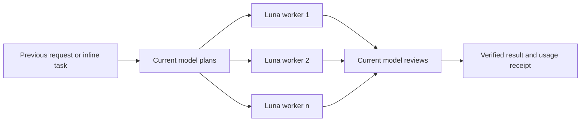

# go-to-luna

> **去月球! · Go To Luna!**

[](https://learn.chatgpt.com/docs/build-skills)
[](https://learn.chatgpt.com/docs/agent-configuration/subagents)
[](LICENSE)

English · [简体中文](README.zh-CN.md)

Use your current Codex model to plan and review. Send the execution-heavy work to one or more GPT-6 Luna workers at `low`, `medium`, `high`, or `xhigh` reasoning effort.

```text
$go-to-luna high sub n=3 -- Implement the approved migration plan and run the tests.
```

Go To Luna! is designed for users who want to preserve scarce main-model capacity without giving up main-model judgment. It supports invisible subagents and user-visible new tasks, then returns one reviewed result with a transparent usage receipt.

`go-to-luna` is the canonical skill name and invocation identifier. “去月球! · Go To Luna!” is the marketing name.

## Highlights

- **Main model stays in charge** — the selected conversation model owns planning, work breakdown, integration, and final review.
- **Luna does the volume work** — every worker defaults to `gpt-6-luna` (with an explicit `gpt-5.6-luna` opt-in); the skill never silently falls back to a more expensive model.
- **Four effort levels** — route work to Luna with `low`, `medium`, `high`, or `xhigh` reasoning.
- **Two execution modes** — use lightweight subagents or visible, independently inspectable Codex tasks.
- **Bounded parallelism** — choose `n=1..4`, or let `n=auto` match the number of genuinely independent work packages.
- **Honest savings report** — see estimated main-model tokens offloaded and credit-weighted savings, without pretending that parallelism always reduces total raw tokens.

## How it works



The coordinator creates disjoint, self-contained work packages. Workers return results and evidence. The coordinator resolves conflicts, performs proportionate verification, and allows at most one focused repair round.

## Install

Clone the repository into your personal Codex skills directory:

```bash
git clone https://github.com/jerryyeungisjingyang/go-to-luna.git ~/.codex/skills/go-to-luna
```

Restart Codex if the skill is not discovered immediately. You can also copy the repository folder into another supported skills location.

## Usage

```text
$go-to-luna [low|medium|high|xhigh] [sub|task] [n=auto|1..4] [model=luna6|luna5.6] [-- <task>]
```

| Control | Values | Default | Meaning |
| --- | --- | --- | --- |
| Effort | `low`, `medium`, `high`, `xhigh` | `medium` | Reasoning effort for every Luna worker |
| Mode | `sub`, `task` | `sub` | Hidden subagents or user-visible new tasks |
| Workers | `n=auto`, `n=1..4` | `n=auto` | Automatically chosen or requested worker count |
| Worker model | `model=luna6`, `model=luna5.6` | `model=luna6` | `gpt-6-luna` or the previous-generation `gpt-5.6-luna` |
| Task | text after `--` | previous request | Explicit work to execute |

Codex skills use the portable `$skill-name` invocation shown above. A `/go-to-luna` command works only in clients that explicitly map slash commands to skills.

### Use the previous request

```text
$go-to-luna low
```

The skill selects the most recent actionable user request, not an assistant status message or the invocation itself.

### Supply a task directly

```text
$go-to-luna medium sub n=auto -- Audit this repository, fix the confirmed defects, and run focused tests.
```

### Create visible Luna tasks

```text
$go-to-luna high task n=3 -- Research the three proposed approaches and produce a reviewed recommendation.
```

New-task mode is explicit: child tasks appear in the sidebar and can be inspected independently. The invoking task remains the final reviewer and delivers the unified answer.

### Use Extra High reasoning

```text
$go-to-luna xhigh sub n=2 -- Trace the intermittent concurrency failure and verify every edge case.
```

Use `xhigh` only for especially demanding reasoning. It is slower and consumes more Luna tokens than lower effort levels.

## Execution modes

| Mode | Best for | Trade-off |
| --- | --- | --- |
| `sub` | Repository work, independent analysis, compact background delegation | Workers remain inside the current task; shared-file ownership must be explicit |
| `task` | Long-running work or results the user may want to inspect separately | More visible coordination; files and git state may require deliberate integration |

Both modes preserve the user's authorization boundaries. Delegation does not grant permission to publish, message others, delete data, or perform other external side effects.

## Usage receipt

Every run ends with a receipt like this:

```text
Go To Luna!: Luna high × 3 · Subagent
Main-model work offloaded: ~32,000 tokens (88.89%)
Estimated weighted-usage saving: ~84.44%
Total raw-token saving: not claimed
Basis: estimated coordinator 3k input + 1k output; workers 24k input + 8k output
Verification: focused tests passed
Remaining risks: none
```

In this illustrative GPT-6.1 Sol example, the same 36,000 routed tokens would cost about `3.60` weighted credits if all work ran on Sol. Keeping 4,000 coordinator tokens on Sol and routing 32,000 worker tokens to Luna costs about `0.56`, an estimated reduction of `84.44%` under the bundled rate card.

This is an estimate of **main-model workload and weighted usage**, not a promise that the ChatGPT Plus meter will fall by the same percentage. Parallel workers may increase total raw tokens because they need instructions, context, and review.

Calculate a receipt from measured or estimated counts:

```bash
python3 scripts/estimate_usage.py \
  --main-model gpt-6.1-sol \
  --coordinator-input 3000 \
  --coordinator-output 1000 \
  --worker-input 24000 \
  --worker-output 8000
```

The bundled rate snapshot is documented in [references/usage-estimation.md](references/usage-estimation.md). Update it when official Codex rates change.

## Design boundaries

- The current model plans and reviews; it does not perform the entire worker workload before delegation.
- Workers receive only the context required for their owned package.
- Shared files and external systems have one designated writer.
- Invalid or conflicting arguments are rejected instead of guessed.
- Unavailable Luna execution stops with a clear limitation; there is no costly fallback.
- One targeted repair round prevents open-ended agent loops.

## Repository layout

```text
go-to-luna/
├── SKILL.md                         # Skill contract and orchestration flow
├── agents/openai.yaml              # Codex UI metadata
├── references/subagent-mode.md     # In-task worker protocol
├── references/task-mode.md         # User-visible task protocol
├── references/usage-estimation.md  # Estimation method and rate snapshot
├── scripts/estimate_usage.py       # Reproducible usage calculator
└── tests/test_estimate_usage.py    # Calculator tests
```

## Requirements

- Codex with skills support
- Access to GPT-6 Luna (GPT-5.6 Luna remains selectable during the rollout)
- Subagent tools for `sub` mode or task-management tools for `task` mode
- Python 3.9+ only when using the optional usage calculator

## FAQ

### Does this reduce total tokens?

Not necessarily. It is intended to move execution tokens away from the limited main model and reduce weighted usage. Parallel orchestration can consume more raw tokens overall.

### Why does the current model review the result?

Planning and final judgment benefit most from the model the user deliberately selected. Luna handles bounded, repeatable work packages; the coordinator owns acceptance criteria and integration.

### How many workers should I use?

Start with `n=auto`. More workers help only when the task contains independent work. An indivisible task should stay with one worker.

### Are low, medium, high, and xhigh applied to the coordinator?

No. They apply to Luna workers only. The coordinator keeps the model and reasoning configuration already selected for the current task.

## Development

Validate the skill and run the tests:

```bash
python3 ~/.codex/skills/.system/skill-creator/scripts/quick_validate.py .
python3 -m unittest discover -s tests -v
```

Issues and focused pull requests are welcome. Keep orchestration bounded, make savings claims reproducible, and add tests for calculator changes.

## Acknowledgements

The README structure takes inspiration from the concise positioning, fast start, reference tables, and explicit contribution paths used by [uv](https://github.com/astral-sh/uv), [Visual Studio Code](https://github.com/microsoft/vscode), [Bun](https://github.com/oven-sh/bun), and [OpenAI Skills](https://github.com/openai/skills). The skill organization also builds on [claude-like-codex-code-review](https://github.com/jerryyeungisjingyang/claude-like-codex-code-review).

## License

[MIT](LICENSE) © 2026 jerry_yang
