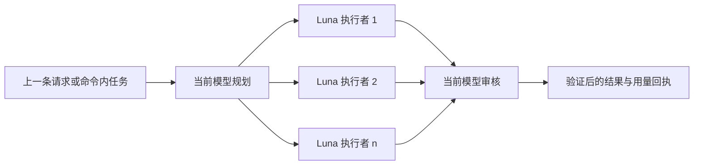

# 去月球! · Go To Luna!

[](https://learn.chatgpt.com/docs/build-skills)
[](https://learn.chatgpt.com/docs/agent-configuration/subagents)
[](LICENSE)

[English](README.md) · 简体中文

让当前 Codex 模型负责规划和终审，把大量执行工作交给一个或多个 GPT-5.6 Luna，并可选择 `low`、`medium` 或 `high` 推理强度。

```text
$go-to-luna high sub n=3 -- 执行已经确认的迁移方案，并完成测试。
```

去月球! 面向希望节省主模型稀缺额度、同时保留主模型判断质量的用户。它支持后台 Subagent 和用户可见的新任务两种模式，最后由当前任务统一审核、整合，并给出透明的用量回执。

## 亮点

- **主模型掌舵**：当前对话所选模型负责规划、拆分、整合和最终审核。
- **Luna 承担执行量**：所有执行者固定使用 `gpt-5.6-luna`，不会静默切换到更昂贵的模型。
- **三档推理强度**：按任务难度选择 `low`、`medium` 或 `high`。
- **两种执行模式**：可使用轻量后台 Subagent，也可创建用户可见、可独立查看的新任务。
- **有界并行**：可指定 `n=1..4`，或用 `n=auto` 按真正独立的工作包自动分配。
- **诚实估算节省**：报告转移了多少主模型工作量、预计节省多少加权额度，不把并行编排误写成总原始 token 必然下降。

## 工作流程



协调者把目标拆成互不冲突、上下文自足的工作包。Luna 返回结果和证据；协调者处理冲突、执行适度验证，并且最多只允许一轮定向返工。

## 安装

将仓库克隆到个人 Codex Skills 目录：

```bash
git clone https://github.com/jerryyeungisjingyang/go-to-luna.git ~/.codex/skills/go-to-luna
```

如果 Codex 没有立即发现 Skill，请重启 Codex。也可以把整个仓库目录复制到其他受支持的 Skills 路径。

## 使用方法

```text
$go-to-luna [low|medium|high] [sub|task] [n=auto|1..4] [-- <任务>]
```

| 参数 | 可选值 | 默认值 | 含义 |
| --- | --- | --- | --- |
| 推理强度 | `low`、`medium`、`high` | `medium` | 所有 Luna 执行者的推理强度 |
| 模式 | `sub`、`task` | `sub` | 后台 Subagent 或用户可见的新任务 |
| 数量 | `n=auto`、`n=1..4` | `n=auto` | 自动选择或显式指定执行者数量 |
| 任务 | `--` 后的文本 | 上一条请求 | 明确指定需要执行的工作 |

Codex Skill 的可移植调用格式是 `$skill-name`。只有客户端明确把斜杠命令映射到 Skill 时，`/go-to-luna` 才能生效。

### 执行上一条请求

```text
$go-to-luna low
```

Skill 会选择最近一条可执行的用户请求，不会误用助手的状态更新或调用命令本身。

### 直接提供任务

```text
$go-to-luna medium sub n=auto -- 审计当前仓库，修复确认的问题，并运行针对性测试。
```

### 创建可见的 Luna 新任务

```text
$go-to-luna high task n=3 -- 分别研究三个候选方案，最终给出审核后的建议。
```

新任务模式必须显式选择。子任务会出现在侧边栏中，可独立查看；发起调用的当前任务仍负责终审和统一交付。

## 两种执行模式

| 模式 | 适合场景 | 代价 |
| --- | --- | --- |
| `sub` | 仓库工作、独立分析、紧凑的后台委派 | 执行者位于当前任务内，共享文件必须明确归属 |
| `task` | 长时间工作，或用户希望分别查看执行结果 | 协调过程更可见，文件和 Git 状态需要有意识地整合 |

两种模式都继承用户原有的授权边界。委派不会自动获得发布、对外发消息、删除数据或执行其他外部副作用的权限。

## 用量回执

每次执行都以类似下面的回执结束：

```text
去月球!: Luna high × 3 · Subagent
主模型转移工作量: ~32,000 tokens（88.89%）
预计加权额度节省: ~83.89%
总原始 token 节省: 不作承诺
估算依据: 协调者 3k 输入 + 1k 输出；执行者 24k 输入 + 8k 输出
验证: 针对性测试通过
剩余风险: 无
```

以上述 GPT-5.6 Sol 示例计算：如果 36,000 个路由 token 全部由 Sol 完成，约需 `7.20` 加权 credits；保留 4,000 个协调 token 给 Sol、把 32,000 个执行 token 交给 Luna，约需 `1.16`，按内置费率表估算降低 `83.89%`。

这是对**主模型工作量和加权用量**的估算，不代表 ChatGPT Plus 用量计数器一定按相同比例下降。并行执行需要重复传递指令、上下文并进行复核，因此总原始 token 可能持平或增加。

可使用实测值或合理估算值生成回执：

```bash
python3 scripts/estimate_usage.py \
  --main-model sol \
  --coordinator-input 3000 \
  --coordinator-output 1000 \
  --worker-input 24000 \
  --worker-output 8000
```

内置费率快照和估算口径见 [references/usage-estimation.md](references/usage-estimation.md)。官方 Codex 费率变化后应同步更新。

## 设计边界

- 当前模型负责规划和终审，不会在委派前先把执行者的全部工作做一遍。
- 每个执行者只接收完成其工作包所需的上下文。
- 共享文件和外部系统必须指定唯一写入者。
- 参数无效或互相冲突时直接报错，不进行猜测。
- Luna 或所选模式不可用时明确停止，不使用昂贵模型兜底。
- 最多一轮定向返工，避免形成无上限 Agent 循环。

## 仓库结构

```text
go-to-luna/
├── SKILL.md                         # Skill 契约与编排流程
├── agents/openai.yaml              # Codex 界面元数据
├── references/subagent-mode.md     # 当前任务内的执行协议
├── references/task-mode.md         # 用户可见的新任务协议
├── references/usage-estimation.md  # 估算方法和费率快照
├── scripts/estimate_usage.py       # 可复现的用量计算器
└── tests/test_estimate_usage.py    # 计算器单元测试
```

## 环境要求

- 支持 Skills 的 Codex
- 可用的 GPT-5.6 Luna 模型
- `sub` 模式需要 Subagent 工具，`task` 模式需要任务管理工具
- 仅在使用可选用量计算器时需要 Python 3.9+

## 常见问题

### 一定会减少总 token 吗？

不一定。目标是把执行 token 从受限主模型迁移到 Luna，并减少加权用量；并行编排可能让总原始 token 增加。

### 为什么必须由当前模型终审？

规划和最终判断最适合交给用户主动选择的模型。Luna 处理边界清晰、可重复的工作包；当前模型负责验收标准和结果整合。

### 应该使用多少个执行者？

建议从 `n=auto` 开始。只有任务能拆成独立工作时，更多执行者才有价值；不可拆分的任务应该只交给一个执行者。

### low、medium、high 会修改当前模型吗？

不会。这三个档位只作用于 Luna 执行者，协调者继续使用当前任务已经选择的模型和推理配置。

## 开发与测试

校验 Skill 并运行测试：

```bash
python3 ~/.codex/skills/.system/skill-creator/scripts/quick_validate.py .
python3 -m unittest discover -s tests -v
```

欢迎提交 Issue 和范围明确的 Pull Request。编排必须保持有界，用量结论必须可复现，计算器变更应补充测试。

## 致谢

README 结构参考了 [uv](https://github.com/astral-sh/uv)、[Visual Studio Code](https://github.com/microsoft/vscode)、[Bun](https://github.com/oven-sh/bun) 与 [OpenAI Skills](https://github.com/openai/skills) 使用的简洁定位、快速开始、参数表和贡献入口。Skill 组织方式也参考了 [claude-like-codex-code-review](https://github.com/jerryyeungisjingyang/claude-like-codex-code-review)。

## 许可证

[MIT](LICENSE) © 2026 jerry_yang
